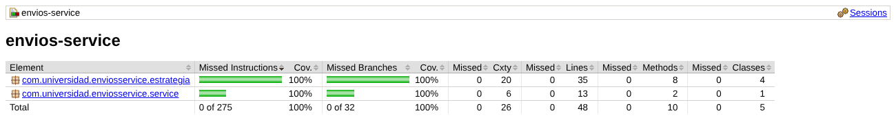
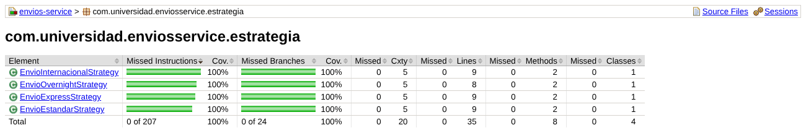

# Envios Service — Análisis de Métricas de Calidad

Post-contenido de la Unidad 10 de Patrones de Diseño de Software (Sebastián Iscala Jurado,
código 1152435). Proyecto Maven plano (`com.universidad:envios-service`, Java 21) que calcula el
costo de un envío según método de transporte, peso, distancia, fragilidad y tipo de cliente.

## Cómo ejecutar

```bash
./mvnw clean verify      # pruebas + reporte JaCoCo en target/site/jacoco/index.html (Windows: mvnw.cmd)
./mvnw sonar:sonar -Dsonar.token=TU_TOKEN   # análisis en SonarQube (http://localhost:9000)
```

`analisis-sonar.ps1` (Windows) hace el proceso completo con Docker: levanta SonarQube, crea el
proyecto y el token, analiza la versión inicial (tag `parte1-inicial`) y la versión actual, toma
las capturas y escribe las métricas reales en este README y en `docs/metricas-sonar.md`.

---

## Parte 1 — Diagnóstico

### Entorno de análisis

SonarQube Community local en Docker (ver Decisión 1):

```bash
docker run -d --name sonarqube -p 9000:9000 -e SONAR_ES_BOOTSTRAP_CHECKS_DISABLE=true sonarqube:community
```

Proyecto `Envios Service`, key `com.universidad:envios-service`. JaCoCo 0.8.13 está en el
`pom.xml` con `prepare-agent` y `report` (fase `verify`), y genera `target/site/jacoco/jacoco.xml`,
que es el archivo que SonarQube lee para la cobertura.

Un detalle de configuración: `mvn sonar:sonar` usa el scanner de Maven, que **no lee**
`sonar-project.properties`; toma las propiedades `sonar.*` del `pom.xml`. Por eso están en los dos
lugares: el `.properties` (comentado) sirve si se usa `sonar-scanner` desde la línea de comandos.

### Estado inicial

Medición con JaCoCo 0.8.13 sobre el código del tag `parte1-inicial` (la clase original y las dos
pruebas de partida):

| Métrica | Valor observado |
|---|---|
| Complejidad ciclomática de `calcularCosto()` (JaCoCo, columna *Cxty*) | **20** |
| Cobertura de líneas de `ServicioCalculoEnvio` | **23,8 %** (10 de 42 líneas) |
| Cobertura de ramas de `ServicioCalculoEnvio` | **18,4 %** (7 de 38 ramas) |
| Cobertura de instrucciones | 14,9 % (37 de 249) |


Valores de SonarQube del mismo código (complejidad, complejidad cognitiva, cobertura y code
smells), tomados de la API del servidor por `analisis-sonar.ps1`:

<!-- sonar-inicial:inicio -->
*Pendiente: se completa al ejecutar `analisis-sonar.ps1`.*
<!-- sonar-inicial:fin -->

### Interpretación

**Qué método concentra el problema.** `ServicioCalculoEnvio` tiene un solo método además del
constructor, y `calcularCosto()` concentra las 20 unidades de complejidad: 19 condiciones
(`if`/`else if`) más 1. Contándolas en el código: 4 para el método de envío, 2 de tramos de peso
en cada uno de los cuatro métodos (8), 3 recargos por distancia (estándar, express, internacional),
la restricción de 300 km de overnight, la fragilidad y 2 del tipo de cliente.

**Qué ramas quedaron sin cubrir.** El reporte de JaCoCo (rojo: no ejecutado; amarillo: solo una
de las dos ramas) muestra que las dos pruebas de partida recorren un único camino: envío
`ESTANDAR` de menos de 5 kg y menos de 500 km, no frágil, cliente `REGULAR` o `PREMIUM`.


| Líneas (código original) | Rama sin cubrir |
|---|---|
| 11–14 | estándar con peso entre 5 y 20 kg y con más de 20 kg |
| 16–17 | recargo estándar por más de 500 km |
| 19–30 | todo `EXPRESS` (tres tramos, recargo y factor 1,3) |
| 31–41 | todo `OVERNIGHT`, incluida la excepción por más de 300 km |
| 42–51 | todo `INTERNACIONAL` (tres tramos y recargo por más de 5000 km) |
| 53–54 | método de envío no soportado |
| 57–58 | recargo por paquete frágil |
| 63–64 | descuento `CORPORATIVO` |

Solo `tipoCliente.equals("PREMIUM")` (línea 61) tiene sus dos ramas cubiertas.

**Por qué coinciden la complejidad y la cobertura baja.** Apuntan al mismo método porque la
complejidad está toda en él: cada condición duplica los caminos posibles y una suite de dos
pruebas solo puede recorrer dos. Con CC = 20 hacen falta al menos 20 casos para cubrir todos los
caminos independientes, y la suite tiene 2; la cobertura de ramas del 18 % es la consecuencia
directa.

---

## Decisiones de diseño

### 1. Entorno de análisis: SonarQube local con Docker

- **Sin exponer el proyecto ni depender de un plan:** SonarCloud gratuito exige que el proyecto
  sea público para analizarlo; con Docker el dashboard queda en la máquina y no depende de los
  límites del plan ni de la conexión.
- **Control total de la configuración:** la Parte 2 exige duplicar el perfil *Sonar way*, cambiar
  el umbral de la regla S1541 y crear un Quality Gate propio. En local se hace con la cuenta de
  administrador, y además se puede automatizar con la API web (`analisis-sonar.ps1`).

El costo aceptado es el de la tabla de la guía: el contenedor consume memoria (Elasticsearch) y
tiene que estar encendido durante el laboratorio, y el dashboard no se puede compartir con un
enlace; por eso las capturas quedan en `docs/`.

### 2. Exclusiones del análisis: ninguna

No se usa `sonar.exclusions`. El proyecto no tiene clase de arranque (`Main`), DTOs generados ni
configuración: todo el código de `src/main/java` es lógica de negocio, que es justamente lo que
el análisis debe medir. Excluir algo solo haría que el porcentaje de cobertura se viera mejor sin
decir nada nuevo sobre la calidad. Las pruebas no se excluyen porque ya están declaradas como
`sonar.tests` y SonarQube no las cuenta en la cobertura. Si más adelante se agregara una clase
`Main` sin lógica, sería la candidata a excluir.

### 3. Métrica usada como señal principal: complejidad ciclomática

Se eligió la complejidad ciclomática, con la cobertura de ramas como confirmación:

- La CC cuenta caminos independientes, que es el número mínimo de casos de prueba para cubrir
  el método. Es la métrica que conecta directamente con el problema de cobertura: CC 20 con 2
  pruebas explica el 18 % de ramas.
- La cobertura sola habría señalado el método, pero no la causa; una cobertura baja se puede
  "arreglar" con más pruebas sin tocar el diseño, y el método seguiría necesitando 20 casos.
- La complejidad cognitiva mide lo difícil que es leer el código (penaliza el anidamiento) y aquí
  también es alta, pero lo que la Parte 2 tiene que reducir es la cantidad de decisiones dentro
  de un mismo método, y eso lo mide la ciclomática. Además, la regla de Quality Profile que se
  configura en la Parte 2 (S1541) es de complejidad ciclomática, así que se usa la misma métrica
  para diagnosticar y para controlar.

---

## Parte 2 — Refactorización guiada por métricas

### 4. Patrón elegido: Strategy

Antes de cambiar el código se revisó qué hacen realmente los condicionales de
`calcularCosto()`:

- **¿Guarda estado entre llamadas?** No. `ServicioCalculoEnvio` no tiene campos; el resultado
  depende solo de los cinco parámetros. No hay un estado que cambie ni transiciones válidas entre
  estados, que es lo que justificaría **State**.
- **¿Hay una secuencia de responsables donde importe el orden?** No. Las cuatro ramas de
  `metodoEnvio` son excluyentes: el valor elige una y solo una, y ninguna "deja pasar" la
  solicitud a la siguiente. En **Chain of Responsibility** varios manejadores podrían aplicar y el
  orden decide cuál resuelve; aquí reordenar las ramas no cambia ningún resultado.
- **¿Cada rama calcula el mismo tipo de resultado con una fórmula propia, elegida una vez por un
  valor?** Sí. Las cuatro ramas producen un costo base a partir de peso y distancia, cada una con
  sus tarifas, sus tres tramos de peso y su recargo o restricción por distancia. Es la señal de
  **Strategy** en la tabla de la guía.

Qué se movió y qué se quedó:

- **A cada estrategia** van los tramos de peso, el recargo por distancia, el factor 1,3 de express
  y la restricción de 300 km de overnight: todo lo que depende de qué método se eligió.
- **En el orquestador** se quedan la búsqueda de la estrategia (con el error para un método no
  soportado), el recargo del 15 % por fragilidad y los descuentos por tipo de cliente. Son reglas
  transversales: valen igual para los cuatro métodos. Meterlas en cada estrategia las duplicaría
  cuatro veces, que es lo que la Unidad 6 llamaría introducir duplicación para bajar un número.

Resultado esperado: `calcularCosto()` pasa de CC 20 a 5 (1 + estrategia nula + fragilidad +
dos tipos de cliente) y cada estrategia queda entre 4 y 5.

### Código después del refactor

```
src/main/java/com/universidad/enviosservice/
├── service/ServicioCalculoEnvio.java        orquestador (CC 5)
└── estrategia/
    ├── EstrategiaEnvio.java                 interfaz: double calcular(pesoKg, distanciaKm)
    ├── EnvioEstandarStrategy.java           CC 4
    ├── EnvioExpressStrategy.java            CC 4
    ├── EnvioOvernightStrategy.java          CC 4 (incluye la restricción de 300 km)
    └── EnvioInternacionalStrategy.java      CC 4
```

```java
EstrategiaEnvio estrategia = estrategias.get(metodoEnvio);
if (estrategia == null) {
    throw new IllegalArgumentException("Metodo de envio no soportado: " + metodoEnvio);
}
double costo = estrategia.calcular(pesoKg, distanciaKm);
if (esFragil) { costo = costo + costo * 0.15; }
if (tipoCliente.equals("PREMIUM")) { costo = costo * 0.9; }
else if (tipoCliente.equals("CORPORATIVO")) { costo = costo * 0.85; }
```

Antes de confirmar el refactor se comparó la versión original (`git show parte1-inicial:...`)
con la nueva en 1680 combinaciones de entrada: los cinco métodos de envío (incluido uno no
soportado), siete pesos y ocho distancias que incluyen los límites (5 y 20 kg; 300, 500 y 5000 km),
los tres tipos de cliente y con y sin fragilidad. No hubo ninguna diferencia, ni en los valores ni
en las excepciones.

### 5. Criterio de las pruebas agregadas

Cada prueba nueva corresponde a una rama que el reporte de JaCoCo de la Parte 1 mostraba en rojo
o amarillo (tabla de la Parte 1). No se agregaron pruebas que repitan el camino que ya estaba
cubierto ni pruebas sin aserción sobre un valor concreto:

| Rama sin cubrir en la Parte 1 (líneas originales) | Prueba que la cubre ahora |
|---|---|
| estándar 5–20 kg y > 20 kg (11–14) | `EnvioEstandarStrategyTest.calcular_porTramoDePeso_...` con 8 y 25 kg, y los límites 5 y 20 kg |
| recargo estándar > 500 km (16–17) | `EnvioEstandarStrategyTest.calcular_porDistancia_...` con 500 (sin recargo) y 501 km |
| todo express (19–30) | `EnvioExpressStrategyTest`: tres tramos y recargo con 500/501 km; verifica que el recargo también se multiplica por 1,3 |
| todo overnight (31–41) | `EnvioOvernightStrategyTest`: tres tramos, el límite de 300 km y la excepción con 301 km |
| todo internacional (42–51) | `EnvioInternacionalStrategyTest`: tres tramos y recargo con 5000/5001 km |
| método no soportado (53–54) | `ServicioCalculoEnvioTest.calcularCosto_metodoNoSoportado_...` (verifica también el mensaje) |
| fragilidad (57–58) | `..._paqueteFragil_agrega15PorCiento` y `..._fragilYPremium_primeroRecargaYLuegoDescuenta` (orden de aplicación) |
| descuento corporativo (63–64) | `..._clienteCorporativo_descuenta15PorCiento` |

Los límites (5 kg, 20 kg, 300, 500 y 5000 km) se probaron a propósito porque un cambio de `<=` por
`<` en cualquiera de ellos no lo detecta una prueba con valores lejanos al límite. Además,
`calcularCosto_combinaciones_coincideConLaVersionOriginal` fija cuatro combinaciones (un caso por
método con fragilidad y cliente) con los valores que daba la clase original.

Una corrección respecto al ejemplo de la guía: para overnight con 25 kg y 100 km la guía espera
250,0, pero con las tarifas del propio método el resultado es 272,5
(100 × 2,0 + 20 + 15 × 2,5 + 5 × 3,0). La prueba usa 272,5, que es lo que devuelve tanto la versión
original como la refactorizada.

### Quality Profile y Quality Gate

Configurados por `analisis-sonar.ps1` con la API web de SonarQube (los mismos pasos que en la
interfaz):

- **Quality Profile "Estándar Laboratorio"** (Java): copia de *Sonar way* con la regla
  `java:S1541` (*Cyclomatic Complexity of methods should not exceed the authorized threshold*)
  activada con `Threshold = 10`, asignado a `envios-service`.
- **Quality Gate "Estándar Laboratorio"**, asignado a `envios-service`:
  - Coverage menor que 70 % → falla.
  - New Code Smells mayor que 0 → falla (si el servidor está en modo MQR, la condición equivalente
    es *New maintainability issues*).
  - Duplicated Lines mayor que 5 % → falla.

### 6. Realismo de los umbrales

**CC = 10 por método.** Es el techo del rango "Moderada" de la tabla 3.2 de la guía y el valor por
defecto de la regla S1541. Con 5, las cuatro estrategias (CC 4 cada una, con tres tramos de peso y
un recargo que son reglas reales del negocio) quedarían en el límite y cualquier tarifa nueva las
haría fallar, empujando a partirlas en métodos artificiales. Con 20, el método original (CC 20)
habría pasado, así que el umbral no habría detectado el problema que motivó el laboratorio. 10
señala `calcularCosto()` original y deja pasar métodos que todavía se leen de una vez.

**Cobertura de 70 %.** Es el mismo umbral que usa la guía como ejemplo para JaCoCo. Exigir 100 %
empuja a escribir pruebas sin valor para cubrir líneas triviales (constructores, getters), que es
el incentivo perverso que describe la sección 2.3. En este proyecto la cobertura real quedó muy por
encima (100 % de ramas medido con JaCoCo), pero el umbral está pensado para cuando el proyecto
crezca con código de infraestructura que no vale la pena probar unitariamente. La condición sobre
code smells nuevos complementa a la cobertura: impide que un método nuevo supere CC 10 aunque esté
bien cubierto.

**Duplicación de 5 %.** Evita la tentación de bajar la complejidad copiando los descuentos dentro de
cada estrategia, que es la alternativa que se descartó en la decisión 4.

---

## Comparación antes / después

Medido con JaCoCo 0.8.13 (mismo código, misma herramienta, antes y después):

| Métrica (JaCoCo) | Antes (Parte 1) | Después (Parte 2) | Cambio |
|---|---|---|---|
| Complejidad ciclomática de `calcularCosto()` | 20 | 5 | −75 % |
| CC máxima de un método en el proyecto | 20 | 5 | |
| Cobertura de ramas de la lógica de envío | 18,4 % (7/38) | 100 % (32/32) | +81,6 puntos |
| Cobertura de líneas | 23,8 % (10/42) | 100 % (48/48) | |
| Pruebas | 2 | 33 (incluye casos parametrizados) | |

La cobertura de ramas "después" incluye `ServicioCalculoEnvio` (8 ramas) y las cuatro estrategias
(6 ramas cada una): la lógica de envío ahora está repartida entre ellas. El total de ramas bajó de
38 a 32 porque desapareció la cadena de cuatro `else if` sobre `metodoEnvio` (reemplazada por la
búsqueda en el mapa).

Medido con SonarQube (lo escribe `analisis-sonar.ps1`):

<!-- sonar-comparacion:inicio -->
*Pendiente: se completa al ejecutar `analisis-sonar.ps1`.*
<!-- sonar-comparacion:fin -->

Detalle del análisis final en SonarQube, incluido el resultado del Quality Gate:

<!-- sonar-final:inicio -->
*Pendiente: se completa al ejecutar `analisis-sonar.ps1`.*
<!-- sonar-final:fin -->

### Capturas de JaCoCo

Antes:


Después:




## Herramientas utilizadas

- Java 21, Apache Maven (wrapper), JUnit 5 (pruebas parametrizadas)
- JaCoCo 0.8.13, SonarQube Community en Docker, sonar-maven-plugin
- PowerShell (automatización del análisis), Git, GitHub

## Conclusiones

La complejidad ciclomática resultó la señal más útil porque explicaba la cobertura: un método con
20 caminos y una suite de 2 pruebas no podía tener más que una cobertura de ramas muy baja. El
análisis de los condicionales antes de elegir el patrón evitó aplicar uno por costumbre: no había
estado ni orden entre las ramas, solo una fórmula distinta por método de envío, así que Strategy
era el que correspondía. La reducción fue real (de 20 a 5) sin repartir la misma lógica en varias
clases, porque las reglas comunes se quedaron en el orquestador. Lo más importante al subir la
cobertura fue escribir cada prueba contra una rama concreta del reporte y contra los valores
límite, en vez de buscar el número; el resultado de 100 % es consecuencia de eso, no el objetivo.
Por último, el umbral del Quality Gate no se escogió como el más exigente posible sino como uno que
detecta el problema original sin obligar a escribir pruebas o métodos artificiales.
