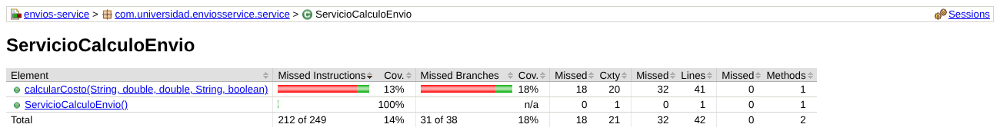
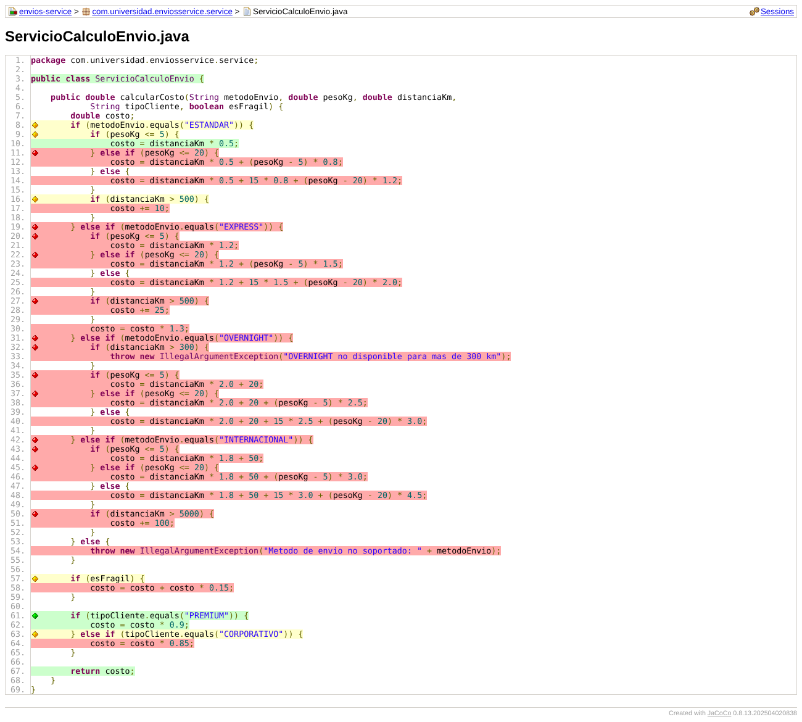

# Envios Service — Análisis de Métricas de Calidad

Post-contenido de la Unidad 10 de Patrones de Diseño de Software (Sebastián Iscala Jurado,
código 1152435). Proyecto Maven plano (`com.universidad:envios-service`, Java 21) que calcula el
costo de un envío según método de transporte, peso, distancia, fragilidad y tipo de cliente.

## Cómo ejecutar

```bash
./mvnw clean verify      # pruebas + reporte JaCoCo en target/site/jacoco/index.html (Windows: mvnw.cmd)
./mvnw sonar:sonar -Dsonar.token=TU_TOKEN   # análisis en SonarQube (http://localhost:9000)
```

`analisis-sonar.ps1` (Windows) hace el proceso completo con Docker: levanta SonarQube, crea el
proyecto y el token, analiza la versión inicial (tag `parte1-inicial`) y la versión actual, toma
las capturas y escribe las métricas reales en este README y en `docs/metricas-sonar.md`.

---

## Parte 1 — Diagnóstico

### Entorno de análisis

SonarQube Community local en Docker (ver Decisión 1):

```bash
docker run -d --name sonarqube -p 9000:9000 -e SONAR_ES_BOOTSTRAP_CHECKS_DISABLE=true sonarqube:community
```

Proyecto `Envios Service`, key `com.universidad:envios-service`. JaCoCo 0.8.13 está en el
`pom.xml` con `prepare-agent` y `report` (fase `verify`), y genera `target/site/jacoco/jacoco.xml`,
que es el archivo que SonarQube lee para la cobertura.

Un detalle de configuración: `mvn sonar:sonar` usa el scanner de Maven, que **no lee**
`sonar-project.properties`; toma las propiedades `sonar.*` del `pom.xml`. Por eso están en los dos
lugares: el `.properties` (comentado) sirve si se usa `sonar-scanner` desde la línea de comandos.

### Estado inicial

Medición con JaCoCo 0.8.13 sobre el código del tag `parte1-inicial` (la clase original y las dos
pruebas de partida):

| Métrica | Valor observado |
|---|---|
| Complejidad ciclomática de `calcularCosto()` (JaCoCo, columna *Cxty*) | **20** |
| Cobertura de líneas de `ServicioCalculoEnvio` | **23,8 %** (10 de 42 líneas) |
| Cobertura de ramas de `ServicioCalculoEnvio` | **18,4 %** (7 de 38 ramas) |
| Cobertura de instrucciones | 14,9 % (37 de 249) |



Valores de SonarQube del mismo código (complejidad, complejidad cognitiva, cobertura y code
smells), tomados de la API del servidor por `analisis-sonar.ps1`:

<!-- sonar-inicial:inicio -->
*Pendiente: se completa al ejecutar `analisis-sonar.ps1`.*
<!-- sonar-inicial:fin -->

### Interpretación

**Qué método concentra el problema.** `ServicioCalculoEnvio` tiene un solo método además del
constructor, y `calcularCosto()` concentra las 20 unidades de complejidad: 19 condiciones
(`if`/`else if`) más 1. Contándolas en el código: 4 para el método de envío, 2 de tramos de peso
en cada uno de los cuatro métodos (8), 3 recargos por distancia (estándar, express, internacional),
la restricción de 300 km de overnight, la fragilidad y 2 del tipo de cliente.

**Qué ramas quedaron sin cubrir.** El reporte de JaCoCo (rojo: no ejecutado; amarillo: solo una
de las dos ramas) muestra que las dos pruebas de partida recorren un único camino: envío
`ESTANDAR` de menos de 5 kg y menos de 500 km, no frágil, cliente `REGULAR` o `PREMIUM`.



| Líneas (código original) | Rama sin cubrir |
|---|---|
| 11–14 | estándar con peso entre 5 y 20 kg y con más de 20 kg |
| 16–17 | recargo estándar por más de 500 km |
| 19–30 | todo `EXPRESS` (tres tramos, recargo y factor 1,3) |
| 31–41 | todo `OVERNIGHT`, incluida la excepción por más de 300 km |
| 42–51 | todo `INTERNACIONAL` (tres tramos y recargo por más de 5000 km) |
| 53–54 | método de envío no soportado |
| 57–58 | recargo por paquete frágil |
| 63–64 | descuento `CORPORATIVO` |

Solo `tipoCliente.equals("PREMIUM")` (línea 61) tiene sus dos ramas cubiertas.

**Por qué coinciden la complejidad y la cobertura baja.** Apuntan al mismo método porque la
complejidad está toda en él: cada condición duplica los caminos posibles y una suite de dos
pruebas solo puede recorrer dos. Con CC = 20 hacen falta al menos 20 casos para cubrir todos los
caminos independientes, y la suite tiene 2; la cobertura de ramas del 18 % es la consecuencia
directa.

---

## Decisiones de diseño

### 1. Entorno de análisis: SonarQube local con Docker

- **Sin exponer el proyecto ni depender de un plan:** SonarCloud gratuito exige que el proyecto
  sea público para analizarlo; con Docker el dashboard queda en la máquina y no depende de los
  límites del plan ni de la conexión.
- **Control total de la configuración:** la Parte 2 exige duplicar el perfil *Sonar way*, cambiar
  el umbral de la regla S1541 y crear un Quality Gate propio. En local se hace con la cuenta de
  administrador, y además se puede automatizar con la API web (`analisis-sonar.ps1`).

El costo aceptado es el de la tabla de la guía: el contenedor consume memoria (Elasticsearch) y
tiene que estar encendido durante el laboratorio, y el dashboard no se puede compartir con un
enlace; por eso las capturas quedan en `docs/`.

### 2. Exclusiones del análisis: ninguna

No se usa `sonar.exclusions`. El proyecto no tiene clase de arranque (`Main`), DTOs generados ni
configuración: todo el código de `src/main/java` es lógica de negocio, que es justamente lo que
el análisis debe medir. Excluir algo solo haría que el porcentaje de cobertura se viera mejor sin
decir nada nuevo sobre la calidad. Las pruebas no se excluyen porque ya están declaradas como
`sonar.tests` y SonarQube no las cuenta en la cobertura. Si más adelante se agregara una clase
`Main` sin lógica, sería la candidata a excluir.

### 3. Métrica usada como señal principal: complejidad ciclomática

Se eligió la complejidad ciclomática, con la cobertura de ramas como confirmación:

- La CC cuenta caminos independientes, que es el número mínimo de casos de prueba para cubrir
  el método. Es la métrica que conecta directamente con el problema de cobertura: CC 20 con 2
  pruebas explica el 18 % de ramas.
- La cobertura sola habría señalado el método, pero no la causa; una cobertura baja se puede
  "arreglar" con más pruebas sin tocar el diseño, y el método seguiría necesitando 20 casos.
- La complejidad cognitiva mide lo difícil que es leer el código (penaliza el anidamiento) y aquí
  también es alta, pero lo que la Parte 2 tiene que reducir es la cantidad de decisiones dentro
  de un mismo método, y eso lo mide la ciclomática. Además, la regla de Quality Profile que se
  configura en la Parte 2 (S1541) es de complejidad ciclomática, así que se usa la misma métrica
  para diagnosticar y para controlar.
